# Benchmark results

Generated by [`.github/workflows/bench.yml`](.github/workflows/bench.yml) from commit `aeb2cc3` on 2026-11-21 03:14 UTC. Raw output is in the workflow run's log.

CPU: AMD EPYC 9V74 80-Core Processor · Go: go1.27.2 · PostgreSQL: 18.7 (Ubuntu 18.7-1.pgdg26.04+2) · 6 runs per benchmark.

Times are the median of the runs. **×** is time relative to the fastest implementation for that
benchmark (1.00× is fastest; 2.00× takes twice as long). Memory is an in-process reference, not a
database, so it's listed for scale but excluded from the rankings. Runs happen on a shared GitHub runner:
compare implementations within this report rather than absolute numbers across reports.

## Summary

Implementations are ranked by **Overall**: the geometric mean of their per-benchmark **×** values, so each
of the 5 benchmarks counts equally however long it takes. **Reads** averages FindAuthorByID, FindAuthorByName, RecentArticles; **Writes** averages InsertAuthors, InsertArticles, each with the rank it alone would give. Equal weighting per benchmark means the
category with more benchmarks has more say in Overall, so check the category your workload resembles.

A rank marked **=** is a tie: the implementation's range of runs overlaps that of the fastest implementation
in its group, so these runs can't tell them apart. An average's range runs from the average of each
benchmark's fastest run to the average of each benchmark's slowest.

What this measures: time only (memory and allocations are in the per-benchmark tables). Each benchmark
calls its operation from 4 goroutines at once (`b.RunParallel`), so Time/op is elapsed time divided by
operations completed: the inverse of throughput under concurrent load, not the latency of one call.
Connection pooling and contention count, and calls go to a PostgreSQL server on the same machine. Server
work is included, so where it dominates (the inserts) differences in library overhead look smaller, and a
remote database would add weight to round trips. Each implementation runs with the driver, protocol and
bulk-insert method chosen in its source file.

| # | Implementation | **Overall** | Reads | Writes | InsertAuthors | InsertArticles | FindAuthorByID | FindAuthorByName | RecentArticles |
|--:|---|--:|--:|--:|--:|--:|--:|--:|--:|
| =1 | PGX | **1.04×** | 1.00× (1st) | 1.11× (=1st) | 1.10× | 1.12× | 1.00× | 1.00× | 1.00× |
| =1 | SQLC | **1.10×** | 1.08× (2nd) | 1.12× (=1st) | 1.15× | 1.09× | 1.06× | 1.13× | 1.05× |
| =1 | PGXStdlib | **1.14×** | 1.21× (3rd) | 1.05× (=1st) | 1.09× | 1.00× | 1.04× | 1.36× | 1.25× |
| 4 | SQLX | **1.23×** | 1.36× (4th) | 1.07× (=1st) | 1.00× | 1.14× | 1.00× | 1.75× | 1.43× |
| 5 | Ent | **1.47×** | 1.58× (=5th) | 1.33× (=5th) | 1.29× | 1.37× | 1.25× | 1.97× | 1.59× |
| =6 | GoPG | **1.55×** | 1.69× (7th) | 1.36× (=5th) | 1.29× | 1.43× | 2.34× | 1.44× | 1.44× |
| =6 | Gorm | **1.56×** | 1.76× (8th) | 1.29× (=5th) | 1.26× | 1.34× | 1.39× | 2.25× | 1.74× |
| =6 | UpperDB | **1.60×** | 1.86× (=9th) | 1.27× (=5th) | 1.22× | 1.32× | 1.33× | 2.59× | 1.87× |
| 9 | BunPGX | **1.70×** | 1.99× (11th) | 1.34× (=5th) | 1.26× | 1.43× | 2.35× | 2.03× | 1.67× |
| =10 | Bun | **1.87×** | 2.26× (=12th) | 1.40× (=10th) | 1.34× | 1.47× | 2.48× | 2.41× | 1.95× |
| =10 | Xorm | **1.91×** | 2.34× (=12th) | 1.40× (=10th) | 1.18× | 1.67× | 1.47× | 3.46× | 2.53× |
| =10 | DBR | **1.97×** | 2.36× (=12th) | 1.51× (12th) | 1.41× | 1.62× | 2.29× | 2.53× | 2.26× |
| 13 | PQ | **2.02×** | 1.85× (=9th) | 2.32× (13th) | 2.50× | 2.15× | 2.50× | 1.46× | 1.73× |
| 14 | Ozzo | **2.42×** | 1.56× (=5th) | 4.67× (14th) | 5.32× | 4.11× | 1.29× | 1.90× | 1.55× |

## InsertAuthors

Each operation: insert a batch of 10 authors.

| # | Implementation | Time/op | ± | × | Memory/op | Allocs/op |
|--:|---|--:|--:|--:|--:|--:|
| =1 | SQLX | 34.3µs | 4% | 1.00× | 3.6 KiB | 61 |
| =1 | PGXStdlib | 37.5µs | 29% | 1.09× | 2.7 KiB | 75 |
| =3 | PGX | 37.9µs | 16% | 1.10× | 2.6 KiB | 73 |
| =3 | SQLC | 39.5µs | 5% | 1.15× | 2.8 KiB | 73 |
| =3 | Xorm | 40.4µs | 3% | 1.18× | 7.3 KiB | 194 |
| =3 | UpperDB | 41.8µs | 4% | 1.22× | 11.2 KiB | 297 |
| =3 | Gorm | 43.0µs | 2% | 1.26× | 7.0 KiB | 119 |
| =3 | BunPGX | 43.1µs | 1% | 1.26× | 5.2 KiB | 19 |
| =3 | Ent | 44.1µs | 1% | 1.29× | 16.7 KiB | 290 |
| 10 | GoPG | 44.2µs | 1% | 1.29× | 1.5 KiB | 21 |
| 11 | Bun | 45.9µs | 1% | 1.34× | 5.1 KiB | 18 |
| 12 | DBR | 48.4µs | 2% | 1.41× | 6.9 KiB | 155 |
| 13 | PQ | 85.6µs | 2% | 2.50× | 67.6 KiB | 109 |
| 14 | Ozzo | 182µs | 25% | 5.32× | 23.5 KiB | 465 |
| ref | Memory | 3.26µs | 3% | — | 1.3 KiB | 11 |

## InsertArticles

Each operation: insert a batch of 10 articles with multi-paragraph bodies.

| # | Implementation | Time/op | ± | × | Memory/op | Allocs/op |
|--:|---|--:|--:|--:|--:|--:|
| =1 | PGXStdlib | 53.3µs | 3% | 1.00× | 30.5 KiB | 111 |
| =1 | SQLC | 57.9µs | 7% | 1.09× | 31.1 KiB | 109 |
| =1 | PGX | 59.6µs | 11% | 1.12× | 30.4 KiB | 109 |
| 4 | SQLX | 60.9µs | 2% | 1.14× | 61.8 KiB | 111 |
| =5 | UpperDB | 70.6µs | 9% | 1.32× | 73.2 KiB | 431 |
| =5 | Gorm | 71.2µs | 3% | 1.34× | 66.1 KiB | 166 |
| =5 | Ent | 73.2µs | 1% | 1.37× | 77.7 KiB | 419 |
| =5 | GoPG | 76.1µs | 2% | 1.43× | 2.7 KiB | 51 |
| =5 | BunPGX | 76.1µs | 5% | 1.43× | 33.5 KiB | 43 |
| =10 | Bun | 78.3µs | 19% | 1.47× | 24.6 KiB | 40 |
| =10 | DBR | 86.2µs | 0% | 1.62× | 54.6 KiB | 247 |
| =10 | Xorm | 88.8µs | 11% | 1.67× | 78.5 KiB | 642 |
| 13 | PQ | 115µs | 0% | 2.15× | 70.3 KiB | 149 |
| 14 | Ozzo | 219µs | 5% | 4.11× | 52.9 KiB | 641 |
| ref | Memory | 2.45µs | 20% | — | 1.8 KiB | 11 |

## FindAuthorByID

Each operation: look up one author by primary key, out of 10,000.

| # | Implementation | Time/op | ± | × | Memory/op | Allocs/op |
|--:|---|--:|--:|--:|--:|--:|
| =1 | PGX | 13.1µs | 6% | 1.00× | 516 B | 8 |
| =1 | SQLX | 13.1µs | 4% | 1.00× | 1016 B | 23 |
| =1 | PGXStdlib | 13.5µs | 10% | 1.04× | 912 B | 20 |
| =1 | SQLC | 13.8µs | 5% | 1.06× | 540 B | 9 |
| =5 | Ent | 16.3µs | 9% | 1.25× | 3.2 KiB | 75 |
| =5 | Ozzo | 16.9µs | 5% | 1.29× | 2.7 KiB | 51 |
| =5 | UpperDB | 17.3µs | 9% | 1.33× | 4.8 KiB | 119 |
| =5 | Gorm | 18.2µs | 3% | 1.39× | 4.0 KiB | 61 |
| 9 | Xorm | 19.2µs | 5% | 1.47× | 4.3 KiB | 110 |
| =10 | DBR | 29.9µs | 5% | 2.29× | 2.0 KiB | 39 |
| =10 | GoPG | 30.5µs | 4% | 2.34× | 912 B | 13 |
| =10 | BunPGX | 30.6µs | 10% | 2.35× | 5.6 KiB | 25 |
| =13 | Bun | 32.3µs | 2% | 2.48× | 5.1 KiB | 14 |
| =13 | PQ | 32.7µs | 4% | 2.50× | 792 B | 24 |
| ref | Memory | 38.0ns | 1% | — | 0 B | 0 |

## FindAuthorByName

Each operation: find the ~1,000 authors sharing a name, out of 10,000.

| # | Implementation | Time/op | ± | × | Memory/op | Allocs/op |
|--:|---|--:|--:|--:|--:|--:|
| 1 | PGX | 149µs | 2% | 1.00× | 89.4 KiB | 3013 |
| 2 | SQLC | 168µs | 2% | 1.13× | 161.7 KiB | 4016 |
| 3 | PGXStdlib | 203µs | 0% | 1.36× | 81.8 KiB | 3998 |
| =4 | GoPG | 215µs | 1% | 1.44× | 84.0 KiB | 3026 |
| =4 | PQ | 217µs | 3% | 1.46× | 81.7 KiB | 4003 |
| 6 | SQLX | 260µs | 2% | 1.75× | 105.4 KiB | 5006 |
| 7 | Ozzo | 283µs | 1% | 1.90× | 155.9 KiB | 5035 |
| =8 | Ent | 294µs | 2% | 1.97× | 240.4 KiB | 8052 |
| =8 | BunPGX | 302µs | 1% | 2.03× | 110.3 KiB | 5013 |
| 10 | Gorm | 335µs | 1% | 2.25× | 134.6 KiB | 7028 |
| =11 | Bun | 359µs | 5% | 2.41× | 109.7 KiB | 5003 |
| =11 | DBR | 377µs | 1% | 2.53× | 106.6 KiB | 5024 |
| 13 | UpperDB | 386µs | 1% | 2.59× | 155.7 KiB | 9098 |
| 14 | Xorm | 515µs | 2% | 3.46× | 442.4 KiB | 17086 |
| ref | Memory | 39.0ns | 0% | — | 0 B | 0 |

## RecentArticles

Each operation: read the 2,000 most recent articles, out of 10,000.

| # | Implementation | Time/op | ± | × | Memory/op | Allocs/op |
|--:|---|--:|--:|--:|--:|--:|
| 1 | PGX | 1.20ms | 1% | 1.00× | 1.7 MiB | 8019 |
| 2 | SQLC | 1.27ms | 2% | 1.05× | 2.2 MiB | 10023 |
| 3 | PGXStdlib | 1.50ms | 1% | 1.25× | 1.7 MiB | 13975 |
| =4 | SQLX | 1.72ms | 1% | 1.43× | 1.8 MiB | 15983 |
| =4 | GoPG | 1.73ms | 1% | 1.44× | 1.7 MiB | 8032 |
| =6 | Ozzo | 1.86ms | 3% | 1.55× | 2.2 MiB | 18006 |
| =6 | Ent | 1.91ms | 8% | 1.59× | 2.3 MiB | 26039 |
| =8 | BunPGX | 2.00ms | 3% | 1.67× | 1.8 MiB | 15993 |
| =8 | PQ | 2.09ms | 2% | 1.73× | 3.1 MiB | 17338 |
| 10 | Gorm | 2.10ms | 1% | 1.74× | 1.9 MiB | 24007 |
| =11 | UpperDB | 2.25ms | 2% | 1.87× | 2.2 MiB | 40054 |
| =11 | Bun | 2.34ms | 2% | 1.95× | 1.8 MiB | 15975 |
| 13 | DBR | 2.72ms | 4% | 2.26× | 1.8 MiB | 16000 |
| 14 | Xorm | 3.05ms | 3% | 2.53× | 3.0 MiB | 60063 |
| ref | Memory | 4.62µs | 2% | — | 16.0 KiB | 1 |

**±** is the largest distance from the median to the fastest or slowest run.
